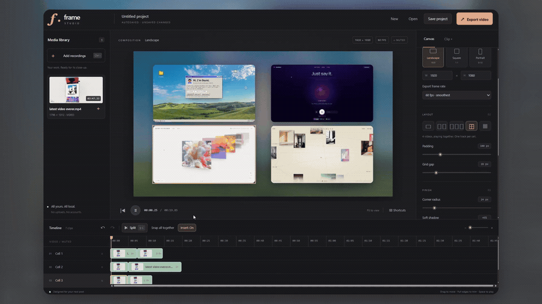
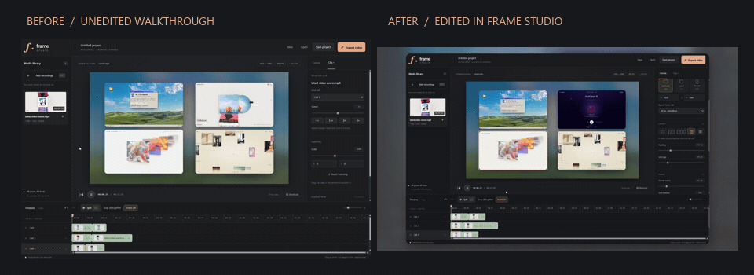
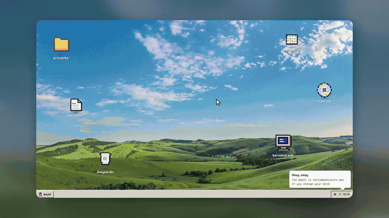
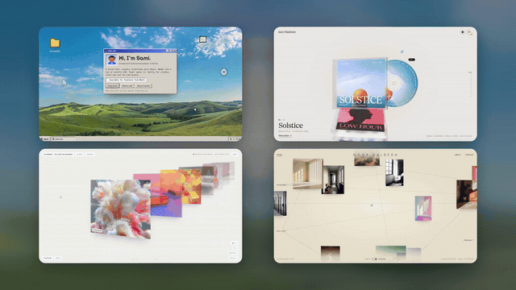
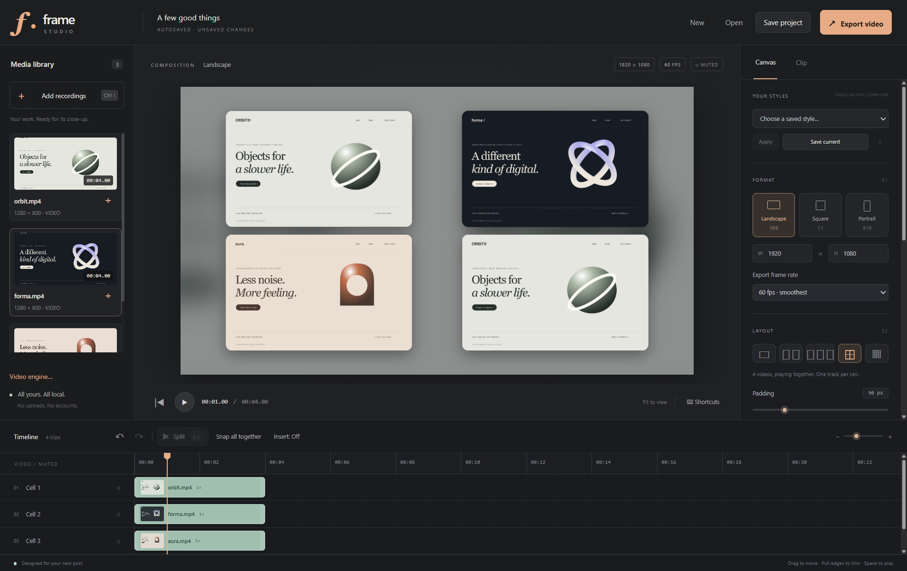
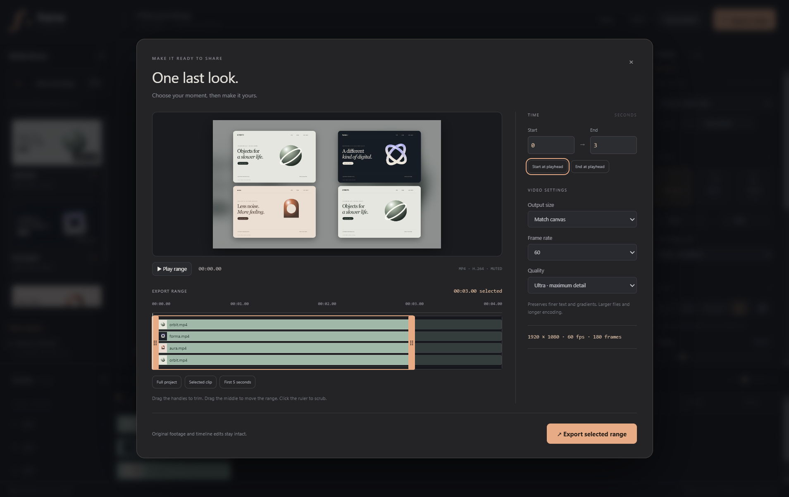

<div align="center">

# Frame Studio

### Good work. Beautifully framed.

A small desktop editor for turning website screen recordings into videos worth sharing.

**Trim it. Speed it up. Give it some breathing room.**

<a href="https://github.com/DanteboIz420/FrameStudio/releases/download/v1.2.2/Frame-Studio-1.2.2-Windows-x64.zip"></a>

[Latest release](https://github.com/DanteboIz420/FrameStudio/releases/latest) · [Quick start](#quick-start) · [How exports work](#how-exports-work) · [Build from source](#build-from-source)

**Windows x64 · Early beta · MIT licensed · No account required**



[Watch the full showcase](https://github.com/DanteboIz420/FrameStudio/releases/download/v1.2.1/Frame-Studio-Showcase.mp4)

</div>

## Made for showing your work

You finished a website. Now you want to post it: cut out the slow bits, speed up the scroll, add rounded corners and a soft shadow, and place it over a blurred background that moves with the recording.

Frame Studio focuses on that workflow. It started as a personal alternative to opening a full motion-design app for every small showcase.

## Before → after



The left clip is the original app walkthrough; the right clip is the polished version edited in Frame Studio. These are excerpts, not a frame-matched comparison.

[Unedited walkthrough](https://github.com/DanteboIz420/FrameStudio/releases/download/v1.2.1/Unedited-Walkthrough.mp4) · [Edited walkthrough](https://github.com/DanteboIz420/FrameStudio/releases/download/v1.2.1/Frame-Studio-Showcase.mp4)

## Made with Frame Studio

<table><tr><td width="50%"></td><td width="50%"></td></tr><tr><td><a href="https://github.com/DanteboIz420/FrameStudio/releases/download/v1.2.1/Outcome-01.mp4">Watch outcome 1</a></td><td><a href="https://github.com/DanteboIz420/FrameStudio/releases/download/v1.2.1/Outcome-02.mp4">Watch outcome 2</a></td></tr></table>

The walkthrough and both outcomes were supplied by the creator. [Showcase media rights](docs/media/LICENSE.md).



## Download

Get the **Windows x64 ZIP** from [the latest release](https://github.com/DanteboIz420/FrameStudio/releases/latest).

1. Extract the **entire ZIP** into a folder. Do not run the app from inside the ZIP.
2. Open **Frame Studio.exe**. Keep it beside the other extracted files.
3. That is it—**FFmpeg is included**. There is no installer, engine download, Node.js requirement, or account setup.
4. Add a recording, or choose **Explore a sample project** to try it immediately.

You do **not** need Node.js or a separate programming environment to use the Windows download. The portable download works offline, including editing and exporting. The current beta is unsigned. macOS and Linux packages are not available yet.

## What you can do

| Edit                                  | Frame                                                 | Export                                       |
| ------------------------------------- | ----------------------------------------------------- | -------------------------------------------- |
| Split, trim, move and duplicate clips | Landscape, square, portrait or custom canvas          | Muted H.264 MP4                              |
| Speed each clip from **1× to 3×**     | Single featured video or **2 / 3 / 4 / 6-cell grids** | **24 / 25 / 30 / 50 / 60 fps**               |
| Snap clips together to remove gaps    | Position, scale, padding and grid gaps                | Full project or a selected time range        |
| Insert mode pushes clips aside        | Rounded corners and soft shadows                      | Draft, High or Ultra quality                 |
| Undo and redo                         | Live blurred video, gradient or solid background      | Output resolution up to 3840 pixels per side |
| Save editable `.frame` projects       | Save and reuse your own style presets                 | Progress, time estimate and cancellation     |

**Autosave and session recovery** help you pick up after an unexpected exit. Each editing window has its own recovery. Saving a project or explicitly discarding its edits clears that session's recovery.

## Quick start

1. **Choose a canvas and layout.** Start with one featured recording, or pick a grid for several websites playing together.
2. **Add your recordings.** Drop files into the app. Empty grid cells fill first; drag a library item onto a timeline track to place it yourself.
3. **Make your cut.** Move the playhead and split, trim the edges, reorder clips, and set their speed. Use **Snap all together** to close gaps, or **Insert: On** to make room when moving footage.
4. **Set your look.** In Canvas, adjust spacing, radius, shadow and the background. In Clip, adjust scale and position. Drag footage in the preview to move it. Save a look under **Your styles** for the next project.
5. **Save, review and export.** Save the editable project, then click **Export video**. Choose your range and video settings in the review panel.

## How exports work



Export opens a review panel before rendering begins:

- **Trim the export range** using the timeline handles or exact start/end seconds. Play the range or scrub the ruler to check it.
- Jump to **Full project**, **Selected clip**, or **First 5 seconds** for a quick test.
- Choose output size, FPS, and quality. The project timeline and original recordings stay intact.

| Quality | Intended use                                                    | Encoding                 |
| ------- | --------------------------------------------------------------- | ------------------------ |
| Draft   | A quick check before the final render                           | H.264, CRF 26, ultrafast |
| High    | A balance of detail, file size and encoding time                | H.264, CRF 20, veryfast  |
| Ultra   | Finer text and gradients, with larger files and slower encoding | H.264, CRF 16, fast      |

All three are lossy H.264 outputs. Videos are **always muted**. Selecting 60 fps does not invent extra motion in a lower-frame-rate recording; frames repeat as needed.

The native FFmpeg pipeline reads the original footage and composites the layout, moving background, rounded masks and shadows. It does not seek and transfer a JPEG for every output frame. Long recordings, multiple simultaneous streams, high resolutions and Ultra quality can still take time. A temporary output is finalized after success; canceled partial exports are removed.

## Shortcuts

| Action                | Windows shortcut                 |
| --------------------- | -------------------------------- |
| Play / pause          | `Space`                          |
| Split selected clip   | `Ctrl+Shift+C` or `Ctrl+Shift+S` |
| Import recordings     | `Ctrl+I`                         |
| Save / save as        | `Ctrl+S` / `Ctrl+Alt+S`          |
| Open project          | `Ctrl+O`                         |
| Undo / redo           | `Ctrl+Z` / `Ctrl+Shift+Z`        |
| Delete selected clip  | `Delete`                         |
| Step one output frame | `←` / `→`                        |
| Jump one second       | `Shift+←` / `Shift+→`            |
| Go to start / end     | `Home` / `End`                   |
| Move without snapping | Hold `Alt` while dragging        |

## Your files stay yours

Recordings and exports are processed on your computer. There is no cloud rendering, account, watermark or analytics service. The Windows ZIP includes its video engine, so using it does not require a runtime download.

Project files and recovery snapshots **reference** your recordings; they do not copy the videos. Keep the source files. If a recording has moved, the app can ask you to locate it. Style presets contain the look, not your footage.

## Current limits

- Early beta, primarily tested on one Windows setup. Different codecs and graphics drivers need more testing.
- H.264 MP4 and WebM are the most reliable inputs. MOV/MKV support depends on the video codec inside the file.
- No audio editing, transitions, text overlays or zoom/pan keyframes yet.
- Shorter grid videos end naturally; they do not loop automatically. Cells hidden by a smaller layout are excluded from export.
- Preview resolution is reduced for responsiveness. The previous decoded frame remains visible while a new scrub position is being read.
- Recovery protects the most recent autosaved state. Use **Save project** for the `.frame` file you want to keep.

## Build from source

Requires **Node.js 22.12+** and npm. The supported package target is Windows x64.

```powershell
git clone https://github.com/DanteboIz420/FrameStudio.git
cd FrameStudio
npm ci
npm run setup:engine
npm start
```

If your npm configuration blocks Electron's download script, run `node node_modules/electron/install.js` once. On other platforms, automatic engine download is unavailable; FFmpeg and FFprobe would need to be installed on PATH, and those platforms are currently untested.

```powershell
npm test
npm run test:setup
npm run test:features
npm run build
```

The portable Windows application is written to `dist/win-unpacked`. Public Windows builds bundle FFmpeg and FFprobe, their GPL license, and the provider’s build information. The release also offers the corresponding FFmpeg source revision. See [development notes](docs/DEVELOPMENT.md), [contributing](CONTRIBUTING.md), and [third-party notices](THIRD_PARTY_NOTICES.md).

## Help shape it

Found a bug or a workflow that could be simpler? [Open an issue](https://github.com/DanteboIz420/FrameStudio/issues). Reproducible examples and small improvements are welcome. This is a focused side project, so feature requests and support are handled as time allows.

The main walkthrough and outcomes above use the creator’s provided recordings. The editor screenshots use original sample sites. See [showcase media](docs/SHOWCASE.md) for replacing the examples with your own before/after recordings or a short walkthrough.

## License

Frame Studio application code and original bundled concept samples are [MIT licensed](LICENSE). The creator’s walkthrough/outcome recordings have [separate media terms](docs/media/LICENSE.md). Third-party software, including Electron and the bundled FFmpeg engine, retains its own licenses. See [third-party notices](THIRD_PARTY_NOTICES.md).

Built by [DanteboIz420](https://github.com/DanteboIz420).
